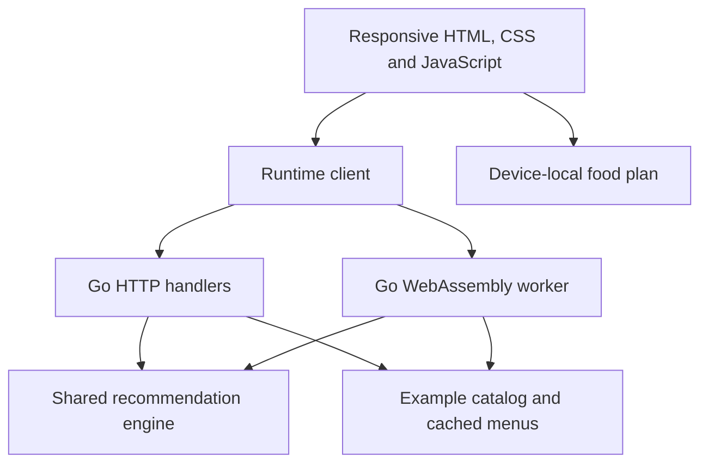

# CineBite architecture — university edition

CineBite is a cinema discovery and food-budget planning prototype for Sri Lanka. The recommender is deterministic and rule based. Catalogs, prices, promotions and schedules are example data. The `scraper` package name is historical; it does not establish a verified live provider integration.

## Responsibilities

| Component | Responsibility | Boundary |
| --- | --- | --- |
| `web` | Shared responsive pages and assets | Food plan is local browser state |
| `internal/server` | JSON decoding, validation, routing, response headers and limits | No user accounts or payment processing |
| `pkg/scraper` | Registered cinema catalog, menus, movie refresh lifecycle | Refresh does not mean externally verified data |
| `pkg/recommender` | Category selection, promotion eligibility, totals and budget enforcement | No learned model or global optimum proof |
| `internal/models` | Shared request and result structures | Legacy aliases retained for compatibility |
| `cmd/api` | Native server and CLI | Native executable is platform-specific |
| `cmd/browser` | WASM entry point | Requires matching runtime assets |

## Recommendation procedure

1. Default a zero party size to two and a nonpositive engine budget to LKR 1,500 per person. The HTTP boundary rejects negative budgets and party sizes.
2. Remove unavailable items from category candidates. Sort popcorn, beverages, snacks and combos by price.
3. Prefer an affordable combo below 85% of budget; otherwise start with popcorn and attempt drinks and snacks. Drinks are capped at four by this heuristic.
4. Evaluate each single-item top-up using the actual requested tier and promo code. Accept a top-up only if the final basket becomes cheaper.
5. Evaluate eligible discounts. If the final amount exceeds the budget, remove the most expensive selected item and recalculate until it fits.
6. If empty, try the cheapest individually affordable in-stock item. Return an explanation and budget remaining.

This is a category heuristic with repair, not a knapsack solver. Given n menu items, p promotion rules and k selected items, sorting is O(n log n), top-up evaluation is O(n(k+p)), and worst-case repeated repair is O(k(k+p)). Working storage is O(n+k). The value score is descriptive and does not drive selection.

## Discount rules

Codes select a campaign; they do not confer membership eligibility. Exactly one eligible campaign with the largest discount is applied. Thresholds are inclusive in code. Percentage discounts have caps; totals are rounded to two decimals. Membership is a selectable demo input, not authenticated entitlement. Production would require trusted membership verification and provider-backed offers. Currency currently uses float64 and rounding; integer minor units would be a useful future change.

## Design tradeoffs

Shared Go code reduces server/browser business-rule drift. WASM increases download size and startup cost. In-memory catalogs and local food plans simplify a university demonstration but provide no multi-device persistence. No usability study, recommendation-quality study, or production scalability result is claimed.
